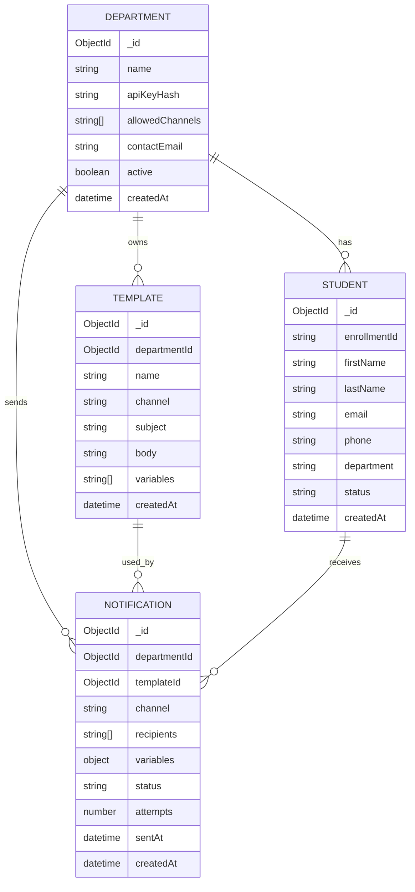

# Notification Microservice - System Architecture

## 1. Overview & Purpose

The Notification Microservice (NMS) is a centralized, multi-channel notification platform designed to simplify how university departments send communications. Instead of each department managing their own email/SMS infrastructure, they submit a single API request to NMS, which handles validation, template rendering, queuing, delivery, and retry logic.

### Key Goals

- **Centralization**: Single point of contact for all notification requirements across departments
- **Reliability**: Built-in auto-retry mechanisms ensure notifications aren't silently dropped
- **Auditability**: Every notification is tracked with status (`pending`, `sent`, `retrying`, `failed_final`)
- **Multi-Channel**: Support for Email, SMS, WhatsApp, and Push Notifications
- **Scalability**: Channel isolation allows independent scaling without interference
- **Consistency**: Centralized template management ensures uniform formatting

### What NMS Does

✅ Receives notification requests from departments via REST API  
✅ Validates payloads and authenticates via API keys  
✅ Stores notification records in MongoDB for history/audit  
✅ Queues notifications in RabbitMQ by channel  
✅ Dispatches to appropriate provider (Resend, Twilio, FCM, etc.)  
✅ Tracks delivery status and retries failed messages  
✅ Receives webhook callbacks for delivery confirmation

### What NMS Does NOT Do

❌ Manage user accounts or student data (received from parent application)  
❌ Store recipient device tokens (managed by client apps)  
❌ Act as a general-purpose message broker (channel-specific only)

---

## 2. High-Level Architecture

```
┌─────────────────────────────────────────────────────────────────────────┐
│                        DEPARTMENTS (Clients)                             │
│                     (Admin, HR, Academics, etc.)                         │
└────────────────────────┬────────────────────────────────────────────────┘
                         │ HTTP POST /api/notifications/send
                         ▼
┌─────────────────────────────────────────────────────────────────────────┐
│                      NEXT.JS API (Microservice)                          │
│              [Validation → Template Render → Persist]                    │
│                                                                           │
│  • Authenticate via API Key (ADMIN_API_KEY)                             │
│  • Validate request schema with Zod                                     │
│  • Render template with variables                                       │
│  • Store notification record in MongoDB                                 │
│  • Route to appropriate channel queue                                   │
└────────────────────────┬────────────────────────────────────────────────┘
                         │
        ┌────────────────┼────────────────┐
        │                │                │
        ▼                ▼                ▼
    ┌────────┐      ┌────────┐      ┌────────┐
    │ Email  │      │  SMS   │      │WhatsApp│
    │ Queue  │      │ Queue  │      │ Queue  │
    └───┬────┘      └───┬────┘      └───┬────┘
        │                │                │
        ▼                ▼                ▼
   ┌─────────────────────────────────────────────┐
   │    RABBITMQ (Message Broker)                │
   │    [Persistent Queue Storage]               │
   └─────────────────────────────────────────────┘
        │                │                │
        ▼                ▼                ▼
   ┌──────────┐    ┌──────────┐    ┌──────────┐
   │  Email   │    │   SMS    │    │ WhatsApp │
   │  Worker  │    │  Worker  │    │  Worker  │
   └──────┬───┘    └──────┬───┘    └──────┬───┘
          │               │               │
          ▼               ▼               ▼
      ┌────────┐      ┌────────┐    ┌─────────┐
      │ Resend │      │ Twilio │    │  Twilio │
      │  API   │      │  API   │    │ WhatsApp│
      └──┬─────┘      └──┬─────┘    └────┬────┘
         │               │              │
         ▼               ▼              ▼
    ┌─────────────────────────────────────────┐
    │    Recipients (Students/Users)          │
    │    [Email, SMS, WhatsApp Inboxes]       │
    └─────────────────────────────────────────┘
         │               │              │
         └───────┬───────┴──────┬───────┘
                 │              │
                 ▼              ▼
          ┌──────────────┐  ┌─────────────┐
          │ Resend       │  │  Twilio     │
          │ Webhooks     │  │  Callbacks  │
          │ (Status)     │  │  (Status)   │
          └──────┬───────┘  └────┬────────┘
                 │               │
                 └───────┬───────┘
                         ▼
                 ┌──────────────────┐
                 │ Webhook Endpoint │
                 │ /api/webhooks/   │
                 │ resend           │
                 └────────┬─────────┘
                          ▼
                  ┌────────────────┐
                  │   Update DB    │
                  │   Set Status   │
                  │   (sent/failed)│
                  └────────────────┘
```

---

## 3. Tech Stack

| Layer                | Technology           | Purpose                                                     |
| -------------------- | -------------------- | ----------------------------------------------------------- |
| **Framework**        | Next.js (App Router) | Backend API + optional Frontend                             |
| **Language**         | TypeScript           | Type-safe development                                       |
| **Database**         | MongoDB + Mongoose   | Persistent storage of notifications, templates, departments |
| **Caching**          | Redis (optional)     | Session cache, rate limiting                                |
| **Message Queue**    | RabbitMQ             | Decouples API from delivery, enables retries                |
| **Email Provider**   | Resend               | Transactional email delivery                                |
| **SMS Provider**     | Twilio               | SMS and WhatsApp messaging                                  |
| **Validation**       | Zod                  | Schema validation for API requests                          |
| **Authentication**   | JWT + API Keys       | Secure endpoint access                                      |
| **Containerization** | Docker               | Deployment consistency                                      |
| **Webhook Handler**  | Native Next.js       | Receives delivery status from providers                     |

---

## 4. Component Breakdown

### 4.1 API Server (Next.js)

**Location**: `app/api/`

**Responsibilities**:

- Accept notification requests from departments
- Validate API keys and rate limit callers
- Render templates with variables
- Persist notification records
- Queue messages to RabbitMQ
- Expose webhook endpoints for provider callbacks

**Key Routes**:

```
POST   /api/notifications                # Submit notification
GET    /api/notifications/[id]           # Fetch notification status
POST   /api/webhooks/resend              # Resend email callbacks
POST   /api/webhooks/twilio              # Twilio SMS callbacks (not yet)
GET    /api/notifications/metrics        # User_Dashboard metrics
POST   /api/auth                         # User authentication
GET    /api/admin/metrics                # Admin_Dashboard metrics
POST   /api/admin/login                  # Admin authentication
```

### 4.2 RabbitMQ (Message Queue)

**What is RabbitMQ?**

RabbitMQ is an open-source message broker that implements the AMQP (Advanced Message Queuing Protocol). It acts as an intermediary that reliably stores and routes messages between producers (API) and consumers (Workers).

**Why RabbitMQ?**

- **Persistence**: Messages survive service restarts
- **Delivery Guarantees**: Supports acknowledgment-based delivery (no loss)
- **Channel Isolation**: Separate queues per notification type (email, SMS, WhatsApp)
- **Scalability**: Multiple workers can consume from same queue
- **Retry Logic**: Dead-letter exchanges for failed messages
- **Management UI**: Built-in dashboard for monitoring

**How it Works**:

```
Producer (API)  →  [Exchange]  →  [Queue]  →  Consumer (Worker)
                        │              ↓
                    Routes message   Stored on disk
                    by binding key   until consumed
```

1. **Producer** (API) publishes message to an Exchange with a routing key
2. **Exchange** matches routing key to one or more Queues based on bindings
3. **Queue** stores message persistently until a Consumer acknowledges receipt
4. **Consumer** (Worker) retrieves message from queue, processes it, sends acknowledgment
5. If Consumer crashes before acknowledgment, message requeued for another worker

**RabbitMQ Role in NMS**:

- Decouples the API from delivery providers (API doesn't wait for email/SMS to send)
- Enables retry without application logic (dead-letter exchange)
- Allows independent scaling of workers (add more workers = faster queue consumption)
- Provides audit trail (messages logged before delivery attempt)

---

### 4.3 Background Workers

**Location**: `workers/`

**Types**:

- `emailWorker.ts` - Consumes email queue, calls Resend API
- `smsWorker.ts` - Consumes SMS queue, calls Twilio API
- `whatsappWorker.ts` - Consumes WhatsApp queue, calls Twilio WhatsApp API

**Responsibilities**:

- Connect to RabbitMQ and consume channel-specific queues
- Transform message payload for provider
- Call third-party provider API
- Handle provider errors and determine if retryable
- Update notification status in MongoDB
- Send message acknowledgment back to queue

**Retry Logic (not yet)**:

```
Attempt 1 → Fail (e.g., timeout)
  ↓
Dead-Letter Exchange routes to retry queue
  ↓
Wait 10 minutes (configurable)
  ↓
Attempt 2 → Fail again
  ↓
After N attempts or exponential backoff → Mark as failed_final
```

---

### 4.4 MongoDB Collections

**Department**:

```javascript
{
  _id: ObjectId,
  name: "Human Resources",
  apiKeyHash: "sha256_hash_of_key",
  allowedChannels: ["email", "sms"],
  contactEmail: "hr@university.edu",
  active: true,
  createdAt: Date
}
```

**Template**:

```javascript
{
  _id: ObjectId,
  departmentId: ObjectId,
  name: "NewStudentWelcome",
  channel: "email",
  subject: "Welcome to {{universityName}}",
  body: "<html>Hi {{studentName}}, welcome...</html>",
  variables: ["studentName", "universityName", "enrollmentId"],
  createdAt: Date,
  updatedAt: Date
}
```

**Notification**:

```javascript
{
  _id: ObjectId,
  departmentId: ObjectId,
  templateId: ObjectId,
  channel: "email",
  recipients: ["student1@uni.edu", "student2@uni.edu"],
  variables: { studentName: "Ahmed", universityName: "Al Akhawayn" },
  subject: "Welcome to Al Akhawayn",
  body: "<html>Hi Ahmed, welcome...</html>",
  status: "pending" | "sent" | "retrying" | "failed_final",
  attempts: 0,
  lastAttemptAt: Date,
  sentAt: Date,
  failureReason: null | "provider_error",
  providerId: "resend_msg_id_123",
  createdAt: Date,
  updatedAt: Date
}
```

**Student**:

```javascript
{
  _id: ObjectId,
  enrollmentId: "STU20240001",
  firstName: "Ahmed",
  lastName: "Hassan",
  email: "ahmed.hassan@uni.edu",
  phone: "+212612345678",
  dateOfBirth: Date,
  department: "Computer Science",
  enrollmentYear: 2024,
  status: "active" | "inactive" | "graduated",
  preferredChannel: "email" | "sms" | "whatsapp",
  notificationPreferences: {
    emailNotifications: true,
    smsNotifications: true,
    whatsappNotifications: false
  },
  createdAt: Date,
  updatedAt: Date
}
```

---

## 5. Data Model

### Entity-Relationship Diagram



### Relationships

| Relationship               | Cardinality | Description                              |
| -------------------------- | ----------- | ---------------------------------------- |
| Department → Templates     | 1:N         | One department owns many templates       |
| Department → Notifications | 1:N         | One department sends many notifications  |
| Department → Students      | 1:N         | One department has many students         |
| Template → Notifications   | 1:N         | One template used for many notifications |
| Student → Notifications    | 1:N         | One student receives many notifications  |

---

## 5.5 Provider Configuration

### 1. Email Provider — Resend

#### Definition

Resend is an email API/service built for developers to send transactional and marketing emails programmatically, without managing SMTP infrastructure directly.

#### What it is

- **Purpose**: Email sending service used for notifications (e.g., ceremony announcements, confirmations).

#### How it works

1. App calls Resend API with `from`, `to`, `subject`, and `html`/`text` body parameters.
2. Resend securely delivers the email payload to the destination mail servers.

#### Limits

- **Quota Restrictions**: Free tier has strict daily and monthly sending caps.
- **Domain Authentication**: Sending domain must be verified via DNS records (SPF, DKIM, DMARC) or emails will land directly in spam.
- **Rate Limiting**: Throttling applies per API key on free/trial plans.

---

### 2. SMS Provider — Twilio

#### Definition

Twilio is a cloud communications platform (CPaaS) that provides APIs to send SMS, calls, and other communications through a global network of telecom carrier partnerships.

#### What it is

- **Purpose**: Twilio Programmable SMS — sends standard text messages via virtual phone numbers.

#### How it works

1. App calls Twilio API with `from`, `to`, and the message body.
2. Twilio routes the packet through regional telecom carriers to reach the device.

#### Limits

- **Media Restrictions**: No reliable MMS/photo support outside the US and Canada.
- **Geo Permissions**: Enforces mandatory activation of target destination countries in the Twilio console.

#### Why it's NOT working (Network Realities)

- **Error Triggered**: `21612 — Moroccan Telecom carrier blocked the message`.
- **Carrier Firewalls**: Moroccan networks (Maroc Telecom, Orange, Inwi) instantly block automated SMS from foreign/unregistered numbers as an anti-spam protection mechanism.
- **Silent Drop**: This is a carrier-level block, not a source code bug. The Twilio API successfully logs a "success" handshake, but the local cell towers drop the packet before it reaches the phone.

---

### 3. WhatsApp Provider — Twilio

#### Definition

Twilio WhatsApp is a messaging channel built on Twilio's API that sends messages through WhatsApp's network instead of the SMS/cellular network.

#### What it is

- **Purpose**: Twilio WhatsApp Business API — routes text and media alerts via WhatsApp instead of the cellular grid.

#### How it works

1. Appends the mandatory `whatsapp:` URI prefix to both sender and recipient number parameters.
2. **Sandbox Flow**: The target device must explicitly text `join <code>` to the sandbox number to opt in.
3. **Production Flow**: Upgrades to a dedicated, Meta-approved business phone number coupled with structured template payloads.

#### Limits

- **Session Leases**: Sandbox opt-in permissions expire automatically after 72 hours of user inactivity.
- **Compliance Checks**: Production environments require official Meta Business approval, which takes verification time.
- **Template Restraints**: Business-initiated conversations must strictly use pre-approved message templates.
- **Asset Requirements**: The `mediaUrl` parameter must point to a direct, static image file link (e.g., ending in `.jpg` or `.png`), not a search page wrapper.

#### Status

- **✅ Currently Working**: Bypasses Moroccan carrier firewalls completely because the delivery runs entirely over the internet protocol rather than cellular base stations.

---

## 6. Key Design Decisions (ADRs)

### 6.1 Channel-Specific Queues

**Decision**: Separate RabbitMQ queue per notification channel (email, SMS, WhatsApp)

**Rationale**:

- Email provider outages don't block SMS delivery
- Each channel scales independently based on traffic
- Channel-specific retry logic (SMS needs different backoff than email)
- Monitoring is per-channel for better visibility

**Alternative Considered**: Single generic queue → Rejected (failure cascade risk)

---

### 6.2 Webhook-Based Status Updates

**Decision**: Providers send delivery status via webhooks rather than polling

**Rationale**:

- Real-time status updates without database load
- Lower latency from provider to NMS
- Reduced API calls to third-party services
- Audit trail of all status changes

---

### 6.3 Separation of Concerns (No User Management)

**Decision**: NMS does NOT manage student/user data

**Rationale**:

- Single responsibility principle
- Parent application owns student data lifecycle
- NMS is delivery-focused only
- Reduces attack surface (NMS not a data honeypot)

---

### 6.4 MongoDB for Notifications

**Decision**: Use MongoDB instead of relational DB

**Rationale**:

- Flexible schema for template variables
- Horizontal scaling through sharding
- Faster writes (journaling with eventual consistency option)
- Good for immutable audit log (append-only collections)

---

## 7. APIs & Interfaces

### 7.1 Send Notification API

**Endpoint**: `POST /api/notifications`

**Authentication**: API Key in header

```bash
curl -X POST http://localhost:3000/api/notifications \
  -H "Authorization: Bearer YOUR_API_KEY" \
  -H "Content-Type: application/json" \
  -d '{
    "templateId": "507f1f77bcf86cd799439011",
    "channel": "email",
    "recipients": ["student@uni.edu"],
    "variables": {
      "studentName": "Ahmed",
      "universityName": "Al Akhawayn"
    }
  }'
```

**Response**:

```json
{
  "success": true,
  "notificationId": "507f191e810c19729de860ea",
  "status": "queued",
  "message": "Notification queued for delivery"
}
```

---

### 7.2 Get Notification Status API

**Endpoint**: `GET /api/notifications/:id`

**Response**:

```json
{
  "_id": "507f191e810c19729de860ea",
  "channel": "email",
  "status": "sent",
  "recipients": ["student@uni.edu"],
  "attempts": 1,
  "sentAt": "2024-08-31T10:30:00Z",
  "providerId": "resend_msg_20240831_abc123"
}
```

---

### 8.3 Resend Webhook Callback

**Endpoint**: `POST /api/webhooks/resend`

**Payload** (from Resend):

```json
{
  "type": "email.sent",
  "created_at": "2024-08-31T10:35:00Z",
  "data": {
    "from_email": "no-reply@zakarianms.me",
    "to_email": "student@uni.edu",
    "email_id": "resend_msg_20240831_abc123",
    "subject": "Welcome to Universiapolis"
  }
}
```

**Actions**:

1. Extract `email_id` from webhook payload
2. Query MongoDB for Notification with `providerId = email_id`
3. Update status to `sent`
4. Log timestamp

**Resend Webhook Types**:

- `email.sent` - Email successfully sent
- `email.delivered` - Email delivered to recipient mailbox
- `email.delivery_delayed` - Email delivery delayed
- `email.opened` - Recipient opened email
- `email.clicked` - Recipient clicked link in email
- `email.bounced` - Email bounced (permanent failure)
- `email.complained` - Recipient marked as spam

---

### 8.4 Twilio SMS Callback

**Endpoint**: `POST /api/webhooks/twilio`

**Payload** (from Twilio):

```json
{
  "MessageSid": "SM1234567890abcdef1234567890abcdef",
  "Status": "delivered",
  "MessageStatus": "delivered"
}
```

**Actions**:

1. Verify Twilio signature (security)
2. Update Notification with `providerId = MessageSid`
3. Set status based on Twilio status code

---

## 9. Security & Authentication

### 9.1 API Key Authentication

**How it Works**:

1. Department registers in NMS admin panel
2. NMS generates random API key (32-character alphanumeric)
3. Key is hashed using SHA-256 before storing in DB
4. Department receives unhashed key (shown once)
5. On each API call, NMS hashes provided key and compares with DB hash

**Implementation**:

```typescript
//  in utils/verifyApiKey.ts
export function verifyApiKey(req: Request): boolean {
  const apiKey = req.headers.authorization?.split(" ")[1];
  if (!apiKey) return false;

  const hash = crypto.createHash("sha256").update(apiKey).digest("hex");
  const dept = db.departments.findOne({ apiKeyHash: hash });
  return dept && dept.active;
}
```

---

### 9.2 User Authentication Flow (OTP & Device Trust)

The NMS user interface employs a strict, multi-step authentication process to ensure only authorized personnel can access department logs and admin controls.

**The Authentication Process:**

**A. Admin Login Flow**

- **Credentials:** The global administrator logs in using a specific **Admin Username** and the master **Admin API Key** (acting as the password).
- **Session:** Once validated, the system issues the `admin_session` JWT cookie, granting full access to system-wide logs, department management, and API key generation.

**B. Department User Login Flow (OTP & Device Trust)**

1. **Initial Login**:
   - The user enters their email and a temporary password provided by the administrator.
2. **OTP Verification**:
   - Upon entering the correct credentials, the system generates a One-Time Password (OTP) and sends it to the user's registered email.
   - The login is paused until the user enters this OTP.
3. **Mandatory Password Reset**:
   - After successfully validating the OTP on their first login, the user is forced to set a new, permanent password to replace the expiring 24-hour temporary password.
4. **Device Trust & Session Creation**:
   - Once the OTP is successfully validated, the system marks the user's current device/browser as "trusted".
   - A secure HTTP-only JWT session cookie (`admin_session`) is issued to the browser.
5. **Session Expiration & Re-verification**:
   - The trusted session is valid for **30 days**.
   - After 30 days, or if the user attempts to log in from a **new, unrecognized device**, the session expires and the user is forced to repeat the OTP verification process.

**Why this approach?**
This prevents unauthorized access even if a temporary password is leaked, as the attacker would also need access to the user's email inbox to retrieve the OTP. It also balances security with usability by only demanding the OTP once every 30 days per device.

### 9.3 JWT for Admin Sessions

**Token Contents**:

```json
{
  "sub": "admin_user_id",
  "iat": 1693469000,
  "exp": 1693472600,
  "role": "admin"
}
```

**Secret**: Stored in `SESSION_SECRET` environment variable

---

### 9.3 Webhook Signature Verification

**Resend Webhooks**:

- Include `X-Resend-Signature` header
- NMS verifies signature using HMAC-SHA256
- Prevents spoofed webhooks

**Twilio Callbacks**:

- Include request signature in header
- NMS uses account auth token to verify

---

### 9.4 HTTPS & TLS

- All external API calls use HTTPS
- Webhook URL must be HTTPS (via Cloudflare Tunnel for local dev)
- Database connections use TLS/SSL

---

## 10. Scalability & Reliability

### 10.1 Horizontal Scaling

**API Tier**: Stateless Next.js instances

- Add more containers behind load balancer
- No session affinity required
- Each instance connects to shared MongoDB + RabbitMQ

**Worker Tier**: Independent worker pools per channel

- Scale email workers independently from SMS workers
- If email queue backs up, just add more email workers
- No impact on other channels

---

### 10.2 High Availability

**Database**: MongoDB Atlas with replica set

- 3-node replica set for automatic failover
- Regular backups

**Message Queue**: RabbitMQ cluster

- Multiple nodes for fault tolerance
- Persistent queues (messages survive broker restart)

**Workers**: Stateless design

- Worker crashes don't lose messages (requeued automatically)
- Can be deployed/updated without queue drain

---

### 10.3 Rate Limiting

**Per Department**: Max N notifications per hour (configurable)

- Prevents single department from overwhelming system
- Stored in Redis with TTL

**Per Provider**: Respect provider rate limits

- Resend: 500 emails/month on free tier
- Twilio: 200 SMS/minute standard

---

### 10.4 Monitoring & Observability

**Key Metrics Tracked**:

- **Delivery Status**: Count of `sent`, `pending`, `retrying`, and `failed_final` states per channel.
- **Queue Health**: Active queue depth, backlog size, and worker acknowledgment rates monitored via the RabbitMQ Management UI (`:15672`).
- **Provider Performance**: Failure reasons and error codes (e.g., rate limits, carrier blocks) logged directly against notification records.

**Logging Strategy**:

- **MongoDB Audit Trail**: Every notification maintains an immutable lifecycle record (timestamps, provider IDs, payload metadata, retry attempts).
- **API & Worker Logs**: Standard output logging for incoming REST payloads, RabbitMQ event dispatches, and provider response handshakes.
- **Webhook Telemetry**: Inbound delivery callbacks (from Resend and Twilio) update notification records in real time to reflect delivery, opens, bounces, or drops.

---

## 11. RabbitMQ via Docker

RabbitMQ is the only component run through Docker in this project. The API, workers, and MongoDB run outside of Docker directly on the host machine.## 12. Known Limitations & Future Work

## 12. Known Limitations & Future Work

### 12.1 Current Limitations

#### SMS Delivery in Morocco

- ❌ Regular Twilio SMS is blocked by carrier firewalls (Maroc Telecom, Orange, Inwi) as anti-spam protection.
- ✅ **Workaround**: Use WhatsApp or Internet-based SMS (Twilio WhatsApp, Vonage).

#### Email Quota Management

- Current system doesn't automatically halt when hitting provider limits.
- **Risk**: A single department could consume the entire Resend monthly free quota.

#### No Recipient Deduplication

- The same email sent to the same recipient in separate rapid requests isn't deduplicated.
- **Risk**: Recipients may receive duplicate emails.

---

### 12.2 Future Enhancements

#### 1. Email Saturation & Provider Upgrade (High Priority)
**Problem**: Resend's free tier has a strict monthly quota (3,000 emails) and a daily cap (100 emails/day) that departments could easily exceed.

**Proposed Solution**: 
- **Immediate Fix (Upgrade)**: Upgrade the Resend account to the **Pro Plan ($20/month)**, which provides 50,000 emails per month and removes daily sending limits. *(Source: [Resend Pricing - Pro Plan](https://resend.com/pricing))*
- **Long-term Strategy**: Implement an internal quota tracker per department to reject API requests before they hit Resend if a department is abusing the system.

- **Alternative (Self-Hosted)**: Evaluate migrating to [Postal](https://docs.postalserver.io/) if the university requires hosting its own email infrastructure. 
  * *Note:* Postal has **no sending limits** (it bypasses third-party billing entirely), but it requires 
  **complex infrastructure configuration** (managing IP reputation, setting up dedicated SMTP servers, handling reverse DNS, and strict deliverability maintenance).

#### 2. Inbound Email Processing (High Priority)

**Problem**: NMS currently only sends outward notifications; it cannot receive replies.
**Proposed Solution**:

- Configure MX records and a receiving provider (like Postmark, SendGrid, or Postal).
- Map incoming emails to specific notification threads and store them in the database.
- Expose an API so department ERPs can fetch replies to their notifications.

#### 3. Smart Retry Strategy (High Priority)

**Current**: Basic retry (same backoff delay for all errors).
**Proposed Solution**: Context-aware retry logic based on specific error types.

- **Immediate Retry**: Network timeouts or temporary connection drops.
- **Short Delay (10m - 1h)**: Provider rate limits (`429 Too Many Requests`).
- **No Retry**: Hard bounces, invalid emails, or carrier blocks (permanently mark as `failed_final`).

#### 4. WhatsApp Business Integration (Medium Priority)

**Current**: Sandbox mode (limited to test numbers).
**Proposed Solution**: Production WhatsApp Business Account.

- Get Meta approval for an official business account.
- Support interactive buttons (e.g., confirm/decline enrollment) and rich media.

#### 5. SMS Provider Diversification (Medium Priority)

**Problem**: Twilio SMS blocked in Morocco.
**Proposed Solution**: Integrate fallback SMS providers.

- **Fallback**: Vonage/Nexmo (different carrier partnerships).
- **Regional**: Direct local Moroccan SMS provider API (e.g., Maroc Telecom API).

#### 6. Rich Email Templates (Low Priority)

**Enhancement**: Move from basic HTML strings to an MJML/Handlebars framework.

- Allows for highly responsive emails across all clients (mobile/desktop).
- Much easier dynamic variable substitution.

#### 7. Template A/B Testing (Low Priority)

**Enhancement**: Allow departments to test two template versions (e.g., different subject lines) on a split subset of recipients to track which yields better open/click rates.

---

## 13. Deployment & Infrastructure Checklist

_Note on Domain Name & Webhooks: We use **Cloudflare Tunnels (`cloudflared`)** as our ingress solution. Instead of opening firewall ports or managing complex reverse proxies (like Nginx), Cloudflare Tunnels securely routes public traffic from our custom domain directly to the Next.js API running on the internal server (port 3000), while handling SSL/HTTPS automatically. This guarantees webhooks from Resend/Twilio reach the local environment securely._

- [ ] Environment variables secured in `.env` vault.
- [ ] MongoDB Atlas cluster provisioned and connected.
- [ ] RabbitMQ Docker container running (`docker-compose up -d`).
- [ ] Node API and Worker processes started (via PM2 or systemd).
- [ ] Domain verified with Email Provider (SPF, DKIM, DMARC records).
- [ ] Cloudflare Tunnel configured and running to map custom domain to `localhost:3000`.
- [ ] Webhook endpoints configured in Resend/Twilio dashboards pointing to the Cloudflare domain.
- [ ] Database indexes created for frequent queries (e.g., `departmentId`, `status`).
- [ ] Security audit completed.

---

## References

- [RabbitMQ Documentation](https://www.rabbitmq.com/documentation.html)
- [Resend Email API](https://resend.com/docs)
- [Twilio SMS API](https://www.twilio.com/docs/sms)
- [MongoDB Mongoose](https://mongoosejs.com)
- [Next.js App Router API](https://nextjs.org/docs/app/building-your-application/routing/route-handlers)
- [Cloudflare Tunnels Docs](https://developers.cloudflare.com/cloudflare-one/connections/connect-networks/)
