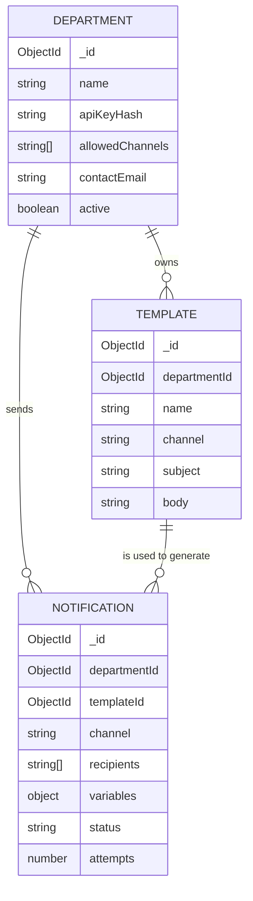

# Architecture

## Overview

This system is a multi-channel notification platform. Internal services submit notification requests to a central Notification Server, which persists request data, then routes the notification to the correct channel-specific
queue (iOS, Android, SMS, or Email).
Dedicated worker pools consume each queue
and deliver the notification through the appropriate third-party provider (APNs, FCM, SMS Service, Email Service) to the end recipient's device.

Splitting the pipeline by channel (rather than using one generic queue/worker pool) allows each channel to scale independently and isolates failures — a slowdown in email delivery, for example, won't block push notifications.

## Flow Diagram

Departments
↓
Notification API
↓
Notification Server
↓
Queue
↓
Worker
↓
Email Provider
↓
Recipient

## Components

-**Service 1…N:** Internal producers (departments/services) that generate events requiring user notification (e.g. order placed, password reset).

-**Notification Servers:** Central entry point. Receives requests from services , validates them, writes/reads request state to a Cache and DB for deduplication and history , and fans the notification out to the correct channel-specific queue based on notification type .

-**Cache:** Fast-access layer in front of the DB, used to reduce load for repeated lookups (e.g. user device tokens, delivery status, rate limiting).

-**DB:** Durable storage for notification records, delivery status, and audit history.

-**Channel Queues (iOS PN / Android PN / SMS / Email):** One queue per channel. Decouples ingestion from delivery and buffers spikes in traffic.The iOS PN queue additionally supports retry on error, re-queuing failed pushes for another delivery attempt .

\-**Workers (per channel):** Independently scalable worker pools that consume jobs from their queue and call the relevant third-party provider .Because each channel has its own workers, one channel's provider issues (e.g. APNs outage) don't starve the others.

# Third-Party Services:

**APNs** — Apple Push Notification service, delivers to iOS devices.
**FCM**— Firebase Cloud Messaging, delivers to Android devices.
**SMS Service** — external SMS gateway/provider.
**Email Service** — external transactional email provider.

-**Recipients (iOS, Android, SMS, Email):** The end devices/channels that ultimately receive the notification .

## Why this design?

--**Channel isolation:** Each notification type has its own queue and worker pool, so a backlog or outage in one channel doesn't affect the others.

--**Resilience via retry:** Failed deliveries (e.g. iOS push) are retried automatically instead of being dropped.
Independent scaling: Worker pools can be scaled up/down per channel based on real traffic patterns (e.g. more SMS volume during a campaign).

--**Decoupling:** Services never call third-party providers directly — they only talk to the Notification Server, which insulates the rest of the system from provider-specific logic and outages.

\--**Fast lookups, durable history:** The cache speeds up common reads (e.g.status checks) while the DB keeps a permanent record for auditing/debugging.

# Database Architecture & Data Models

This document outlines the core database structure for the NMS. The database uses MongoDB (NoSQL) with Mongoose for schema validation and relationship mapping.

## Overview

The system is designed with a strict **Separation of Concerns**. It acts solely as a delivery microservice and does not manage a `Users` collection. Instead, the main application passes recipient data (emails/phone numbers) directly into the notification payloads.

---

## Entity-Relationship Diagram

## Logical Relationships

The data model relies on **One-to-Many (1:N)** relationships established via Mongoose `ObjectId` references:

- **Department ➔ Templates (1:N):** One department can create and own multiple reusable templates. A template cannot exist without a parent department.
- **Department ➔ Notifications (1:N):** One department can trigger thousands of notifications. This link is vital for rate limiting, tracking, and analytics.
- **Template ➔ Notifications (1:N):** A single template can be referenced by thousands of individual notification requests to generate personalized message bodies. This field is optional to allow for one-off, non-templated custom messages.

# Provider Configuration

## 1. Email Provider — Resend

### Definition

Resend is an email API/service built for developers to send transactional and marketing emails programmatically, without managing SMTP infrastructure directly.

### What it is

- **Purpose**: Email sending service used for notifications (e.g., ceremony announcements, confirmations).

### How it works

1. App calls Resend API with `from`, `to`, `subject`, and `html`/`text` body parameters.
2. Resend securely delivers the email payload to the destination mail servers.

### Limits

- **Quota Restrictions**: Free tier has strict daily and monthly sending caps.
- **Domain Authentication**: Sending domain must be verified via DNS records (SPF, DKIM, DMARC) or emails will land directly in spam.
- **Rate Limiting**: Throttling applies per API key on free/trial plans.

---

## 2. SMS Provider — Twilio

### Definition

Twilio is a cloud communications platform (CPaaS) that provides APIs to send SMS, calls, and other communications through a global network of telecom carrier partnerships.

### What it is

- **Purpose**: Twilio Programmable SMS — sends standard text messages via virtual phone numbers.

### How it works

1. App calls Twilio API with `from`, `to`, and the message body.
2. Twilio routes the packet through regional telecom carriers to reach the device.

### Limits

- **Media Restrictions**: No reliable MMS/photo support outside the US and Canada.
- **Geo Permissions**: Enforces mandatory activation of target destination countries in the Twilio console.

### Why it's NOT working (Network Realities)

- **Error Triggered**: `21612 — Moroccan Telecom carrier blocked the message`.
- **Carrier Firewalls**: Moroccan networks (Maroc Telecom, Orange, Inwi) instantly block automated SMS from foreign/unregistered numbers as an anti-spam protection mechanism.
- **Silent Drop**: This is a carrier-level block, not a source code bug. The Twilio API successfully logs a "success" handshake, but the local cell towers drop the packet before it reaches the phone.

---

## 3. WhatsApp Provider — Twilio

### Definition

Twilio WhatsApp is a messaging channel built on Twilio's API that sends messages through WhatsApp's network instead of the SMS/cellular network.

### What it is

- **Purpose**: Twilio WhatsApp Business API — routes text and media alerts via WhatsApp instead of the cellular grid.

### How it works

1. Appends the mandatory `whatsapp:` URI prefix to both sender and recipient number parameters.
2. **Sandbox Flow**: The target device must explicitly text `join <code>` to the sandbox number to opt in.
3. **Production Flow**: Upgrades to a dedicated, Meta-approved business phone number coupled with structured template payloads.

### Limits

- **Session Leases**: Sandbox opt-in permissions expire automatically after 72 hours of user inactivity.
- **Compliance Checks**: Production environments require official Meta Business approval, which takes verification time.
- **Template Restraints**: Business-initiated conversations must strictly use pre-approved message templates.
- **Asset Requirements**: The `mediaUrl` parameter must point to a direct, static image file link (e.g., ending in `.jpg` or `.png`), not a search page wrapper.

### Status

- **✅ Currently Working**: Bypasses Moroccan carrier firewalls completely because the delivery runs entirely over the internet protocol rather than cellular base stations.
